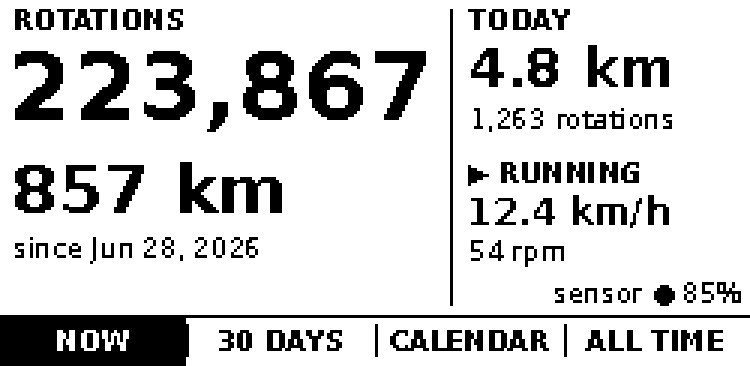
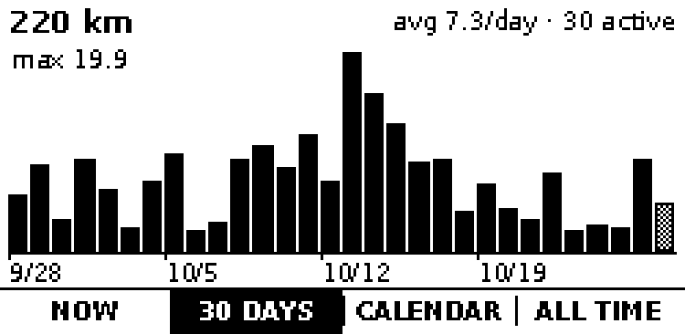
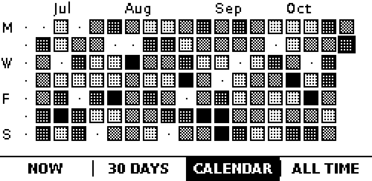
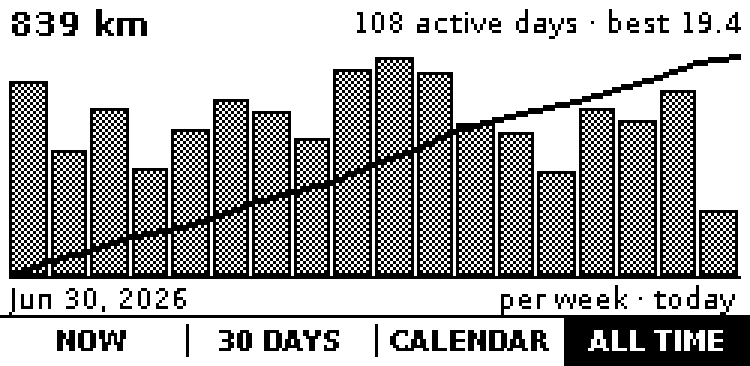

<div align="center">

# purrdometer

An odometer for a cat wheel: tracking distance, speed, and "you won't let me outside" rage runs.

[Why](#why) · [Screens](#screens) · [Web](#web) · [Install](#install) · [Guide](docs/guide/README.md) · [Configuration](docs/guide/configuration.md) · [Contributing](#contributing)



</div>

## Why

My cat, Murder Mittens, runs further than you'd guess. She's on her wheel constantly: when she wakes up, after eating, post-poop zoom-zooms, or when she's angry because she's not allowed outside.

`purrdometer` straps a Bluetooth cadence sensor to the 6-ft hamster wheel in my living room and hooks up a small e-paper display beside it. This lets me keep track of how many rotations she logged, how far she actually ran, and how her physical activity is somehow higher than mine on any given day.

## Screens

Four screens, picked from the touch bar along the bottom edge.

<table>
<tr>
<td width="50%"></td>
<td width="50%"></td>
</tr>
<tr>
<td colspan="2" align="center"></td>
</tr>
</table>

## Web

You can also view history in a browser at http://whiskerwheel:8080. It's served by a tiny C++ binary that compiles pages directly into C++—taking up a few megabytes of RAM and responding in tens of milliseconds, even on a Pi Zero.


## Features

- **Resilient logging:** Logs every rotation to SQLite, catching up on missed events if the logger restarts: [the sensor](docs/guide/sensor.md).
- **Diameter presets:** Computes distance using your wheel's actual running diameter (common brand presets included, or set custom cm/inches). History recomputes automatically if you change it: [configuration](docs/guide/configuration.md).
- **E-paper UI:** NOW, 30 DAYS, CALENDAR, and ALL TIME views on a 2.13" touch e-paper HAT: [screens](docs/guide/screens.md).
- **Web dashboard & API:** Local web interface with a settings page and JSON API: [web](docs/guide/web.md).
- **Robust BLE link:** Built to survive the Pi Zero 2 W's shared WiFi/Bluetooth radio without dropping connection: [troubleshooting](docs/guide/troubleshooting.md#a-sensor-that-keeps-dropping).
- **Single package setup:** One `.deb` installs everything and sets up systemd services: [install](docs/guide/install.md).

## Install

On a Raspberry Pi Zero 2 W with the Waveshare 2.13" Touch e-Paper HAT:

Flash the Raspberry Pi image from the
[latest release](https://github.com/marek/purrdometer/releases/latest) with
Raspberry Pi Imager (set the user and WiFi in its OS customisation), or install
the `.deb` on a Pi running Raspberry Pi OS trixie:

```sh
sudo apt install ./purrdometer_*_arm64.deb
```

Then spin the wheel to wake the sensor. The details are in
[install](docs/guide/install.md).

| Hardware | |
|---|---|
| Computer | Raspberry Pi Zero 2 W, Raspberry Pi OS trixie or later |
| Screen | Waveshare [2.13inch Touch e-Paper HAT (with case)](https://www.waveshare.com/product/raspberry-pi/displays/e-paper/2.13inch-touch-e-paper-hat-with-case.htm): 250×122, capacitive touch, a case that holds the Pi Zero |
| Sensor | Any Bluetooth LE cycling cadence sensor (built with a Garmin one) |
| Wheel | One of the popular brands with a preset, or any wheel with a known diameter |

## Documentation

The [guide](docs/guide/README.md) covers installing, the sensor, the screens,
the web dashboard, configuration, troubleshooting and development.

## Contributing

purrdometer is built by agentic development with intents, tests and
implementation. Start with [AGENTS.md](AGENTS.md) and
[development](docs/guide/development.md).

## License

[Apache-2.0](LICENSE.md).
