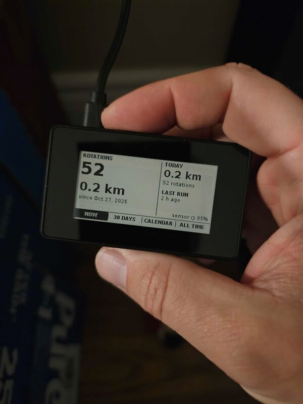

# Install

The hardware, installing the package, and upgrading or removing it.

## Hardware

<p align="center"></p>

| Part | Notes |
|---|---|
| Raspberry Pi Zero 2 W | Raspberry Pi OS trixie (64-bit) or later, on WiFi |
| Waveshare [2.13inch Touch e-Paper HAT (with case)](https://www.waveshare.com/product/raspberry-pi/displays/e-paper/2.13inch-touch-e-paper-hat-with-case.htm) | 250×122, the V4 panel with the GT1151 touch controller; the case holds the Pi Zero behind it. The image turns SPI and I²C on; on your own install, `sudo raspi-config` → Interface Options |
| Bluetooth LE cadence sensor | Any Cycling Speed and Cadence sensor with crank data; built against a Garmin cadence sensor |
| Cat wheel | Presets for the Ferris Cat Wheel G5, Grand Ferris, One Fast Cat and Star Cat L and XL; any wheel works once its diameter is set ([configuration](configuration.md)) |

## Flash the image

The simplest way: download `purrdometer_<version>_raspios-trixie-arm64.img.xz`
from the [latest release](https://github.com/marek/purrdometer/releases/latest)
and flash it with [Raspberry Pi Imager](https://www.raspberrypi.com/software/):
**Choose OS → Use custom**, pick the file, then use **OS customisation** to
set the user, the WiFi and SSH. The image is Raspberry Pi OS Lite (trixie,
64-bit) with purrdometer installed and SPI and I²C turned on; on first boot it
grows to fill the card.

## Or install the package

On a Pi already running Raspberry Pi OS trixie, download the `.deb` from the
latest release, or build it (below), and install it:

```sh
sudo apt install ./purrdometer_*_arm64.deb
```

Either way the package:

- installs and starts four services: `purrdometer-logger` (Bluetooth to the
  database), `purrdometer-display` (the screen), `purrdometer-web` (the
  [web dashboard](web.md) on port 80) and `purrdometer-setup` (the WiFi
  hotspot and setup page's helper, which runs as root);
- sets Bluetooth's LE supervision timeout to 6 s and turns WiFi power-save
  off, which keeps the sensor connected ([troubleshooting](troubleshooting.md#a-sensor-that-keeps-dropping));
- creates a `purrdometer` system user and `/var/lib/purrdometer` for the history.

The screen shows NOW with zeros until the wheel turns. Spin the wheel to wake
the sensor; the logger finds it by itself ([the sensor](sensor.md)).

## WiFi from a phone

A Pi with no WiFi set up starts **setup mode** by itself, and a running one
does when you hold the touch bar for three seconds, or hold the screen while
it starts. The screen shows a hotspot name, its password and a QR code. Join
it from your phone and the setup page opens (or go to `http://10.42.0.1`):
choose your WiFi and its password, and optionally a login password, SSH and
the wheel. The Pi joins your WiFi and the screen shows its new address, and
says under it if the login password or SSH could not be set. If
nothing is sent within ten minutes, the hotspot closes and the Pi goes back
to the WiFi it had.

## Build it yourself

On an arm64 machine with podman or docker (an Apple-silicon Mac, for example):

```sh
git clone https://github.com/marek/purrdometer && cd purrdometer
packaging/build-in-container.sh                 # about 20 seconds; dist/*.deb
scp dist/purrdometer_*_arm64.deb whiskerwheel:
ssh whiskerwheel 'sudo apt install ./purrdometer_*_arm64.deb'
```

Building on the Pi itself also works (`packaging/build-deb.sh`, after
installing the packages in `packaging/build-deps`), but a full build takes
over ten minutes there.

## Upgrade

Build and install the new package the same way. Settings in
`/etc/purrdometer/purrdometer.conf`, the settings page's, your wheels and the
history are kept. Upgrading from 1.0 moves `/var/lib/purrdometer/settings.ini`
to `settings.conf`, and makes the wheel set there your first wheel profile,
with all history under it; distances do not change.

When Raspberry Pi OS upgrades `bluez`, apt may ask about a changed
`/etc/bluetooth/main.conf`. Keep the installed version (the default answer):
it holds purrdometer's timeout.

## Remove

```sh
sudo apt remove purrdometer   # stops the services; settings and history kept
sudo apt purge purrdometer    # also takes the Bluetooth setting out again
```

The history in `/var/lib/purrdometer` is kept even by a purge. Delete it by
hand if you really want it gone. A purge cannot restore what the package
changed and did not record: Bluetooth stays unblocked, BlueZ learns its
connection parameters again, and a setting of the same name that was in
`main.conf` before is not brought back.
