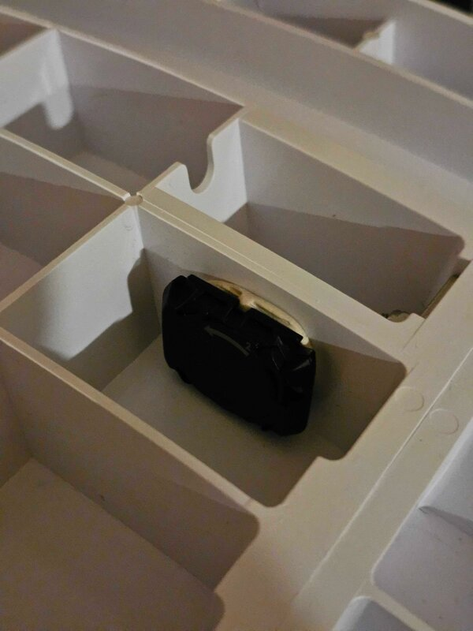

# The sensor

A Bluetooth cycling **cadence** sensor (made for a crank) works; purrdometer
is built and tested with a Garmin one. A **speed** sensor (made for a wheel
hub) is read the same way by the standard, but none has been tried yet. Either
way, one revolution it reports is one turn of the cat wheel. Choosing it, mounting it and testing it
are all on the dashboard's settings page (the gear), under **Sensor**.

## Mounting

- **Cadence sensor:** fix it to the **back side** of the wheel, away from the
  cat, with the face of the sensor parallel to the wheel, the way it sits on
  a bike's crank arm. It counts turns of its own orientation, like a clock
  hand going round. On the outside of a Ferris G5 it counted every turn.
- **Speed sensor:** on the axle or hub, as on a bicycle hub (untested).
- Keep the **battery door reachable**. Glue the sensor's holder to the wheel
  and seat the sensor in it, instead of gluing the sensor down.
- One wheel rotation is one "crank revolution" to the sensor.

## Choosing it

Wake the sensor by turning it, then press **Scan for sensors** on the settings
page. Every cadence and speed sensor the Pi hears is listed with its name,
kind, signal and when it was last heard; the one in use shows **connected**
and its battery. Pick one and **Save**, or leave **Automatic**, which takes the
first sensor heard and keeps it. A new choice applies within a second, without
a restart.

The sensor sends data only while it detects rotation. A connected sensor on a
still wheel is silent, and that is normal.

## Waking up

The sensor sleeps after a few minutes without turning. Rocking the wheel does
not wake it, nor do single turns with pauses: it takes about three full turns
in a row. It misses about its first two turns after waking, then counts
every one. purrdometer adds those two as an estimate, kept apart from what
the sensor measured; the number is **Turns the sensor misses waking up** on
the settings page (0 counts only what it measures).

## Testing it

Under **Test**, press **Start test** and turn the wheel: the count of
rotations and the rpm update every second. Nothing is saved by the test
itself; the rotations are the real ones the logger stores.

## Battery

The battery level is read on each connection and shown on NOW. A battery
change restarts the sensor's count from zero; the logger sees the count go
back and adds what the sensor counted since, so no turn is lost.

## Changing sensors

Choose the new sensor on the settings page (scan first if it is not listed).
The history is kept, and nothing is counted across the switch.
