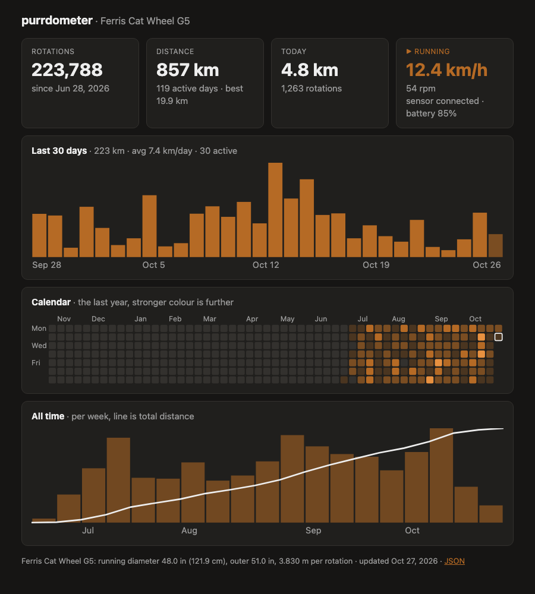

# The web dashboard

The same history as the screen, in a browser on your home network:

**http://whiskerwheel/**

The old address, `http://whiskerwheel:8080/`, redirects there.



| Part | Shows |
|---|---|
| Cards | Total rotations and since when; total distance, active days and the best day; today; live speed while the wheel turns, otherwise when the last run was; the sensor and its battery |
| Last 30 days | A bar per day, today lighter while it is still going |
| Calendar | The last year, a square per day, stronger colour for further |
| All time | Bars per day, week or month since the first day, with a line for the total distance |

Hover a bar or a square for its date and distance. The page refreshes itself:
every 5 seconds while the wheel turns, every 30 seconds otherwise. It follows
your browser's light or dark setting.

## Settings

The gear at the top right opens the settings:

- **Wheels:** your wheels, each with its model or measured diameter and its
  distance. **Edit** corrects a wheel, and says how far its distance moved.
  **New wheel** adds one and puts it in use: add it when you move the sensor,
  and the old wheel keeps its distance. **Use this wheel** switches back to an
  earlier one ([configuration](configuration.md#wheels)).
- **Units:** cm or inches, for how sizes are shown.
- **Sensor:** which one, how to mount it, a live test ([the sensor](sensor.md)).
- **Screen:** upside down, how often it updates.

**Save** applies them at once to the dashboard, and to the screen before its
next update. **Reset to defaults** goes back to the config file; it never
touches your wheels.

By default any device on your home network can save. To change that, set
`settings_access` in `/etc/purrdometer/purrdometer.conf`:

| `settings_access` | Who can save |
|---|---|
| `lan` | Any device on the home network (the default) |
| `pin` | Anyone who types `settings_pin` |
| `open` | Anyone who can reach the page |
| `off` | Nobody; edit the config file instead |

Everyone can still look at the settings page. Where the page may not save, it
says why. The network settings (`bind`, `port`) and the access rule itself are
only in the config file.

## JSON

`http://whiskerwheel/api/stats` has the same numbers for scripts: the
wheel in use, totals (with `estimated_rotations`, the turns the sensor missed
waking up), today, live state and every day with rotations.

## In the config file

In `/etc/purrdometer/purrdometer.conf`:

```ini
[web]
bind = 0.0.0.0          # 127.0.0.1 to allow only the Pi itself
port = 80
legacy_port = 8080      # redirects to port; 0 for none
settings_access = lan   # lan, pin, open or off
#settings_pin = 2468
```

Then `sudo systemctl restart purrdometer-web`. The dashboard has no login, so
keep it on the home network. It uses the same `[wheel]` setting as the screen
([configuration](configuration.md#wheel)).

## Not loading?

```sh
systemctl status purrdometer-web
journalctl -u purrdometer-web -n 20
curl http://localhost/healthz      # on the Pi: prints ok
```
